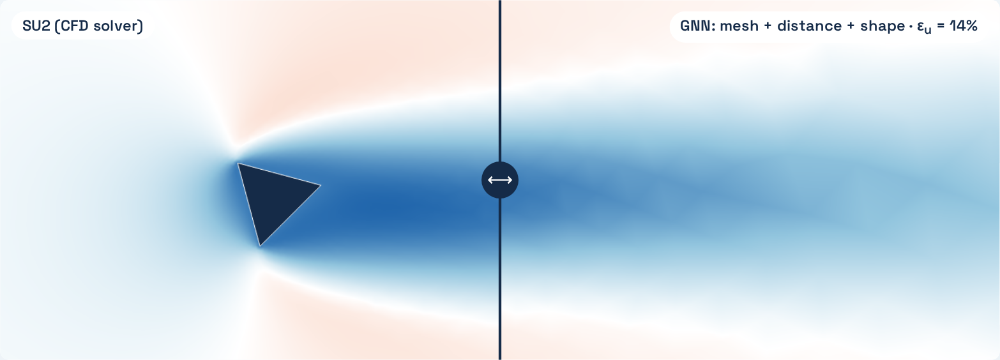

# FlowGNN



**What must each point know for a graph neural network to predict flow?**

[The interactive explanation](https://ru7herford.github.io/flowgnn/) (eleven pages).

A graph neural network (GNN) works on the mesh as a graph: each mesh point is a node and each mesh
edge is a link. Each of its 12 layers is one round: each node adds the messages from its links, and an
MLP (a small neural network) updates the node's 64 numbers. A decoder then computes velocity (u, v) and
pressure p. This is the MeshGraphNets architecture ([Pfaff et al. 2021](https://arxiv.org/abs/2010.03409)),
predicting the steady flow in one pass ([Harsch and Riedelbauch 2021](https://arxiv.org/abs/2105.02575)).
I trained it on 34 shapes that SU2 (a CFD solver) solved, at Reynolds number 40, and tested it on 6
triangles (a shape type that is not in the training data) and 4 new airfoils.

After 12 rounds, a node has information from nodes up to 12 links away (its receptive field). Many
nodes in the wake (the slower flow behind the obstacle) are farther than that from it. This is a known limit of message-passing GNNs; the
usual fixes are more layers, coarse long-range links ([Fortunato et al. 2022](https://arxiv.org/abs/2210.00612))
or a global input at every node ([Battaglia et al. 2018](https://arxiv.org/abs/1806.01261)). So I trained
the same network four times, M0 to M3, with different information about the obstacle in each node's inputs.

## Results

Velocity error ε<sub>u</sub> = ‖**u**<sub>GNN</sub> − **u**<sub>SU2</sub>‖ / ‖**u**<sub>SU2</sub> − **U**<sub>∞</sub>‖ over all mesh points, with
**u** = (u, v). 0% is exact. 100% is the same as predicting the inflow **U**<sub>∞</sub> everywhere. Each value is the mean of three trained
networks (seeds); the range is in brackets.

| Network | Inputs of each node | ε<sub>u</sub>, 6 test triangles | ε<sub>u</sub>, 4 test airfoils |
|---|---|---:|---:|
| M0 | mesh only: position and boundary type | 20.5% (20.1–21.0) | 9.9% (9.6–10.2) |
| M1 | mesh + distance and direction to the obstacle | 21.9% (19.9–23.7) | 6.8% (6.3–7.6) |
| M2 | mesh + shape: six measurements of the obstacle | 14.2% (13.5–14.9) | 4.2% (4.1–4.4) |
| M3 | mesh + distance + shape | 13.5% (12.9–14.3) | 3.4% (3.1–3.5) |

The six shape inputs decrease the error the most. The distance input alone decreases the error only
on the airfoils. Pressure error ε<sub>p</sub> = ‖p<sub>GNN</sub> − p<sub>SU2</sub>‖ / ‖p<sub>SU2</sub>‖.

Influence distribution, adapted from [Xu et al. 2018](https://arxiv.org/abs/1806.03536): the influence
of node j on the prediction at node i is the sum of |∂u<sub>i</sub>/∂(inputs of j)|, normalised over all
nodes. Here u<sub>i</sub> is the predicted horizontal velocity u at node i, not a hidden state, and only node inputs
count. For wake nodes, its mean link distance is 5.7 for M0, 3.0 for M1, 0.8 for M2 and 0.6 for M3 (two
test shapes, three wake points, three seeds). With the shape as an input, a prediction depends mostly
on the node and its direct neighbours. This is local sensitivity at the actual inputs.

M3 predicts a test shape in 0.01 s on an RTX 4060 graphics card (0.09 s on the CPU). SU2 took 78 s to
20 minutes (median 4 minutes, 6 threads) on a mesh with 9 times more points.

## Why these numbers

| Choice | Value | Reason |
|---|---|---|
| Flow | Reynolds number 40, steady, laminar | Below the onset of vortex shedding behind a circle (about 47–49, [Williamson 1996](https://doi.org/10.1146/annurev.fl.28.010196.002401)), so one steady solution per shape exists. Every obstacle is at most 1 tall, so no obstacle's Reynolds number exceeds 40. |
| Solve mesh | 0.0125 at the wall to 0.5; 35–41k points | Circle check on three meshes: drag, wake length and separation angle change by under 1%. Drag and wake length are inside the published spread ([Dennis and Chang 1970](https://doi.org/10.1017/S0022112070001428), [Gautier et al. 2013](https://arxiv.org/abs/1310.6641)); the separation angle, 127.7°, is 0.4° above it and extrapolates to 126.7°, inside it. [Details](data/README.md). |
| Training mesh | 0.05 at the wall to 1.0; about 4,400 points | Solving directly on it shortens the circle's wake by 19%; refining it makes every graph about nine times larger. So the flow is solved fine and stored coarse. |
| Shapes | 50: 34 training, 6 validation, 10 test | Chosen, not tuned (all 50 SU2 runs took 3.9 hours). No triangles are in training, to test a new shape type. Training on half the shapes raised the validation error from 16.3% to 47.1% (M0) and from 5.5% to 10.1% (M3), one seed (`scripts/half_data.py`), so more data would very likely help. |
| Rounds | 12 | Measured (seed 0, 150 epochs, `examples/rounds_*.json`): on the validation shapes M0 gets 21.7%, 16.3% and 15.8% with 6, 12 and 18 rounds, while M3 stays near 5.3%; on the test shapes 18 rounds do not help M0 (21.1% against 21.2%). 18 rounds cost 40% more time. [MeshGraphNets](https://arxiv.org/abs/2010.03409) uses 15. |
| Numbers per node | 64 | Chosen, not tuned; MeshGraphNets uses 128. |
| Position input | absolute x, y of each node | The channel never moves, so position tells a node where the inlet and walls are. MeshGraphNets uses only relative positions (on the links), so its networks do not depend on where things are. |
| Training | 300 epochs; the saved weights are from the epoch with the lowest validation loss (normalised mean squared error of u, v and p, checked every 10 epochs) | Measured: 300 beats 150 on the validation shapes for both M0 (16.3% → 11.9%) and M3 (5.5% → 3.9%), seed 0; M0 stays on a plateau until about epoch 100. |
| Mirrored shapes | every training shape and its top-to-bottom mirror image | The channel is symmetric about y = 0, so the mirror image is an exact solution: twice the training graphs at no solver cost. Chosen, not tested on its own. |
| Optimiser | Adam, learning rate 1e-3 (one-cycle), batch of 4 shapes | Common defaults, not tuned. |
| Seeds | 3 | The fewest that show a spread; the page shows the seed with the median validation error. |
| Training replay | every 2 epochs, M0 and M3 at their shown seeds | Smooth enough to watch (152 frames). A rerun with the same settings is close, not identical: GPU arithmetic is not bit-for-bit repeatable (mean test ε<sub>u</sub> 16.6% vs 16.1% for M0, 9.2% vs 9.1% for M3). |

## Limits and checks

The results are for one flow type (steady, Reynolds number 40), one channel and 34 training shapes.
The error also increases inside the 12-link receptive field, so the receptive field does not explain
all of the error. The tests check the graph, the model, the data and the page data, each message on
the page against the saved network, and each influence value against a finite difference.

## Run it

```sh
pip install -r requirements.txt
python flowgnn.py                 # train the four networks, three seeds each
python flowgnn.py --config examples/watch.json   # the training replay: M0 and M3, every 2 epochs
python scripts/timing.py          # prediction time against SU2's solve time
python scripts/export_page.py     # rebuild docs/data/ from the saved runs
python flowgnn.py --config examples/rounds_6.json    # also rounds_12 and rounds_18: the rounds study
python scripts/half_data.py       # half the training shapes
```

The dataset is included. Rebuilding it needs SU2 8.5.0 and `requirements-data.txt`:
`python scripts/data/make_data.py` meshes, solves and stores every shape, and
`python scripts/data/validate_circle.py` repeats the solver check.

To view the page locally without training: `python -m http.server 8000`, then open
`http://localhost:8000/docs/`. Checks: the five `tests/test_*.py` scripts, and `python scripts/check_page.py`
(needs `requirements-page.txt` and `playwright install chromium`). `python scripts/make_cover.py`
redraws the picture above.

## Code and sources

`src/graph.py` makes the inputs. `src/model.py` is the network. `src/inspect.py` records the messages
and computes the influence distributions, after each round and of the prediction. `scripts/timing.py`
measures the prediction time. `scripts/data/` makes the dataset. `docs/graph.js` draws the One round,
How far and Influence slides; `docs/app.js` draws the other slides.
[Export format](docs/data/README.md).

[MeshGraphNets](https://arxiv.org/abs/2010.03409) (Pfaff et al., 2021),
[graph networks](https://arxiv.org/abs/1806.01261) (Battaglia et al., 2018),
[MultiScale MeshGraphNets](https://arxiv.org/abs/2210.00612) (Fortunato et al., 2022),
[steady flow in one pass](https://arxiv.org/abs/2105.02575) (Harsch and Riedelbauch, 2021),
[influence distribution](https://arxiv.org/abs/1806.03536) (Xu et al., 2018),
[SU2](https://doi.org/10.2514/1.J053813) (Economon et al., 2016), circle flow at Reynolds number 40:
[Dennis and Chang (1970)](https://doi.org/10.1017/S0022112070001428),
[Gautier et al. (2013)](https://arxiv.org/abs/1310.6641); cylinder wake regimes:
[Williamson (1996)](https://doi.org/10.1146/annurev.fl.28.010196.002401).

MIT; [LICENSE](LICENSE). SU2 and Gmsh made the data and are not bundled.
Space Grotesk uses the [SIL Open Font License](docs/fonts/OFL.txt).
